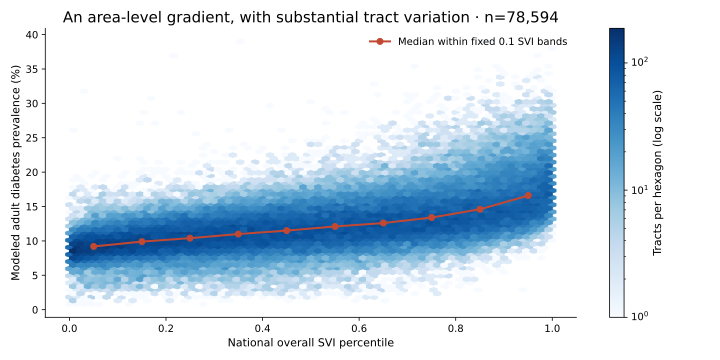
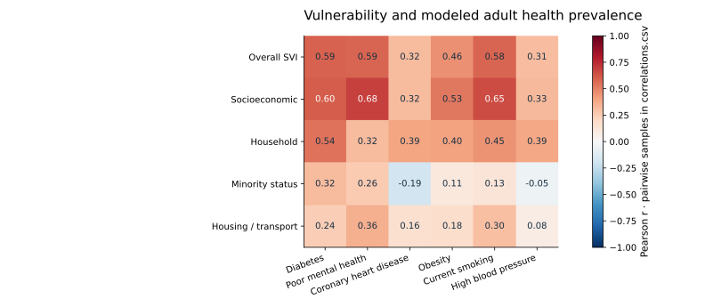
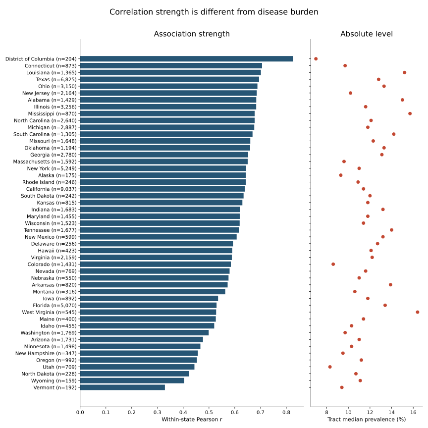

# Social vulnerability & modeled health: a validated rerun

**Rough draft for review — 2026-10-01.** Generated from the original local CDC cache. This is a cross-sectional tract analysis, not individual prediction or causal evidence.

## The result that survives

The original join reproduces **78,815 tracts**. Median modeled adult diabetes prevalence is **9.5%** in tracts with national SVI <0.2 (n=15,481) and **15.6%** with SVI >0.8 (n=16,120): **6.1 percentage points**, or **1.64×**. These are unweighted medians of tract estimates; they are not population prevalence or an individual relative risk. Threshold bands use strict inequalities, preserving the historical calculation; they are not equal-size quintiles in the joined sample.

## What changed about the evidence

- On 2026-10-01, the cached SVI file was **byte-for-byte identical** to CDC's official 2022 US tract CSV, authenticating its national rank scope. All **472,890 selected PLACES records** matched the current official **2025 release** in tract/measure identifiers, observation years, crude estimate type, point estimates and both interval endpoints. CDC's archived **2024 release** metadata specifies 2022 BRFSS for most measures and 2021 for high blood pressure; it does not describe these selected records. The filename is therefore misleading for the analyzed content. Original acquisition date and the other 34 cached PLACES measures remain unauthenticated. See `source_authentication.json` for exact endpoints, page hashes and comparison fields.
- SVI has 84,120 tracts, with 83,342 valid overall ranks. 5,305 SVI tracts lack a selected PLACES record; 0 selected PLACES tracts lack SVI. **Kentucky and Pennsylvania are entirely absent** for these six outcomes: 4,751 tracts and 17,492,143 people in cached SVI estimates. CDC's 2025 release notes report both states unavailable for 2023 BRFSS-based measures. The remaining 554 unmatched tracts require separate investigation. Each correlation reports its own complete-pair n.
- Matched tracts account for 313,597,796 of 331,097,593 people in the cached SVI population estimates (94.71%). The full SVI total equals the Census Bureau's published 2018–2022 ACS US population total. This is coverage of ACS all-age estimates, not the PLACES adult denominator or a national disease-prevalence estimate.
- Selected rows are uniquely keyed by tract and measure, crude prevalence only, all 2023. The former `first` pivot happened to reproduce these values, but would silently conceal duplicate years/types in another input. The new runner rejects those inputs.
- SVI 2022 uses 2018–2022 ACS estimates. PLACES 2025 uses 2023 BRFSS for the six selected measures and 2020 Census population geography. ACS 2022 uses 2020 tract delineations subject to legal-area updates; Connecticut adopted planning-region county equivalents. Matched identifiers and SVI county prefixes are checked, but exact boundary identity remains unaudited. These are overlapping period estimates, not a simultaneous 2022 measurement or a longitudinal design.

## Does the association depend on the summary method?

The national Pearson/Spearman results below use complete pairs. State and county columns correlate deviations from group means, removing between-group mean differences; they are not averages of group-specific correlations, a spatial-dependence correction or control for all confounders. Age sensitivity residualizes both quantities against an intercept and SVI ACS all-age percentages aged 65+ and 17 or younger on a common complete-case sample. This also removes constituents of SVI's household theme and does not estimate an independent theme effect. It is a coarse linear composition check, not CDC age-standardization; CDC does not publish age-adjusted tract estimates. All estimates are descriptive and unweighted.

<table border="1" class="dataframe">
  <thead>
    <tr style="text-align: right;">
      <th>measure</th>
      <th>n</th>
      <th>pearson</th>
      <th>spearman</th>
      <th>state_centered</th>
      <th>county_centered</th>
      <th>age_composition_partial</th>
    </tr>
  </thead>
  <tbody>
    <tr>
      <td>DIABETES</td>
      <td>78594</td>
      <td>0.589</td>
      <td>0.616</td>
      <td>0.622</td>
      <td>0.597</td>
      <td>0.642</td>
    </tr>
    <tr>
      <td>MHLTH</td>
      <td>78594</td>
      <td>0.585</td>
      <td>0.617</td>
      <td>0.637</td>
      <td>0.653</td>
      <td>0.576</td>
    </tr>
    <tr>
      <td>CHD</td>
      <td>78594</td>
      <td>0.316</td>
      <td>0.325</td>
      <td>0.353</td>
      <td>0.362</td>
      <td>0.504</td>
    </tr>
    <tr>
      <td>OBESITY</td>
      <td>78594</td>
      <td>0.460</td>
      <td>0.457</td>
      <td>0.597</td>
      <td>0.703</td>
      <td>0.431</td>
    </tr>
    <tr>
      <td>CSMOKING</td>
      <td>78594</td>
      <td>0.580</td>
      <td>0.595</td>
      <td>0.680</td>
      <td>0.698</td>
      <td>0.561</td>
    </tr>
    <tr>
      <td>BPHIGH</td>
      <td>78594</td>
      <td>0.308</td>
      <td>0.291</td>
      <td>0.367</td>
      <td>0.367</td>
      <td>0.422</td>
    </tr>
  </tbody>
</table>

## Geography changes the question

Strong within-state correlation does not mean high statewide disease burden, intervention effectiveness, or greater inequality. The right panel shows an unweighted median of tract estimates, alongside each state's correlation and sample size. State comparisons retain the cached US SVI rankings and are descriptive sensitivity checks; no state-specific SVI ranking was downloaded. National rank scope was authenticated by byte comparison to the official US CSV.

Lowest tract matching coverage (full table in `coverage_by_state.csv`):

<table border="1" class="dataframe">
  <thead>
    <tr style="text-align: right;">
      <th>STATE</th>
      <th>svi_tracts</th>
      <th>matched_tracts</th>
      <th>tract_coverage_pct</th>
      <th>population_coverage_pct</th>
    </tr>
  </thead>
  <tbody>
    <tr>
      <td>Kentucky</td>
      <td>1306</td>
      <td>0</td>
      <td>0.00</td>
      <td>0.00</td>
    </tr>
    <tr>
      <td>Pennsylvania</td>
      <td>3445</td>
      <td>0</td>
      <td>0.00</td>
      <td>0.00</td>
    </tr>
    <tr>
      <td>Hawaii</td>
      <td>436</td>
      <td>426</td>
      <td>97.71</td>
      <td>99.98</td>
    </tr>
    <tr>
      <td>Michigan</td>
      <td>2972</td>
      <td>2904</td>
      <td>97.71</td>
      <td>99.99</td>
    </tr>
    <tr>
      <td>New York</td>
      <td>5394</td>
      <td>5289</td>
      <td>98.05</td>
      <td>100.00</td>
    </tr>
  </tbody>
</table>

CDC documents the Kentucky/Pennsylvania exclusion. Of the other 554 unmatched SVI tracts, 456 have zero ACS estimated population and 98 have positive estimated population; together they account for 7,654 people. CDC applies a 2020 Census adult population threshold of at least 50 for PLACES. ACS all-age counts cannot establish whether a particular tract fails that threshold, so individual exclusion reasons remain unresolved. `unmatched_tracts.csv` records identifiers for follow-up. Missing coverage need not be random. The state figure includes 48 states and DC, not all 50 states.

## Uncertainty belongs in the deliverable

<table border="1" class="dataframe">
  <thead>
    <tr style="text-align: right;">
      <th>MeasureId</th>
      <th>rows</th>
      <th>point_nonmissing</th>
      <th>interval_nonmissing</th>
      <th>median_interval_width_pp</th>
    </tr>
  </thead>
  <tbody>
    <tr>
      <td>BPHIGH</td>
      <td>78815</td>
      <td>78815</td>
      <td>78815</td>
      <td>6.60</td>
    </tr>
    <tr>
      <td>CHD</td>
      <td>78815</td>
      <td>78815</td>
      <td>78815</td>
      <td>1.50</td>
    </tr>
    <tr>
      <td>CSMOKING</td>
      <td>78815</td>
      <td>78815</td>
      <td>78815</td>
      <td>4.80</td>
    </tr>
    <tr>
      <td>DIABETES</td>
      <td>78815</td>
      <td>78815</td>
      <td>78815</td>
      <td>3.20</td>
    </tr>
    <tr>
      <td>MHLTH</td>
      <td>78815</td>
      <td>78815</td>
      <td>78815</td>
      <td>4.10</td>
    </tr>
    <tr>
      <td>OBESITY</td>
      <td>78815</td>
      <td>78815</td>
      <td>78815</td>
      <td>9.80</td>
    </tr>
  </tbody>
</table>

Widths are the median of published tract-level 95% interval widths, in percentage points. The runner preserves both endpoints in the processed long table. These intervals describe CDC modeled estimates, not confidence intervals for our correlations or median-band contrast. No independence-based p-values, aggregate confidence bands, or Bayesian posterior are reported: spatial dependence, shared model inputs and unavailable joint uncertainty draws would make such precision easy to overstate. SVI rank uncertainty is also not propagated.

PLACES is produced by multilevel regression and poststratification using demographic variables, county poverty and geographic effects. SVI includes related demographics and socioeconomic measures. Some observed association can therefore reflect overlapping model inputs; this is not an independent validation of vulnerability against directly observed tract disease counts. CDC cautions against using PLACES estimates to evaluate local programs or policies.

## Interpretation corrections

Ordinary entries in a correlation matrix do **not** implicitly adjust for the other columns. The old minority-theme discussion incorrectly called them residual associations. Negative or small aggregate correlations cannot establish a protective mechanism, access barrier, dietary explanation, or Hispanic paradox. We retain the signs and flag the need for a separate, justified investigation. Literature concerning mortality, counties or individuals does not validate a tract prevalence effect size.

The minority-theme/CHD correlation is -0.190 nationally, 0.065 after county mean-centering, and 0.044 in the coarse age-composition sensitivity check (n=78,804). Its sign changes under these descriptive checks. That is evidence that the unadjusted demographic pattern is sensitive to composition and geography, not evidence of a protective mechanism or an independently estimated racial effect.

## Sources and reproducibility

- [CDC SVI downloads and national/state ranking guidance](https://svi.cdc.gov/dataDownloads/data-download.html)
- [CDC SVI 2022 documentation](https://svi.cdc.gov/map25/data/docs/SVI2022Documentation_ZCTA.pdf): ACS period, sentinels and ranks; accessed 2026-10-01.
- [CDC PLACES dataset](https://data.cdc.gov/500-Cities-Places/PLACES-Local-Data-for-Better-Health-Census-Tract-D/cwsq-ngmh): currently labeled 2025; accessed 2026-10-01.
- [CDC PLACES methodology](https://www.cdc.gov/places/methodology/index.html): modeled estimates, input overlap, intervals and 2020 geography; accessed 2026-10-01.
- [CDC PLACES release notes](https://www.cdc.gov/places/current-release-notes/index.html): omitted states and observation years; accessed 2026-10-01.
- [CDC archived 2024 tract dataset](https://data.cdc.gov/500-Cities-Places/PLACES-Local-Data-for-Better-Health-Census-Tract-D/ai6z-tcin): release versus observation-year distinction; accessed 2026-10-01.
- [Official SVI 2022 US tract CSV](https://svi.cdc.gov/Documents/Data/2022/csv/states/SVI_2022_US.csv): national ranking authentication; accessed 2026-10-01.
- [CDC PLACES FAQs](https://www.cdc.gov/places/faqs/index.html): absence of age-adjusted tract estimates; accessed 2026-10-01.
- [CDC PLACES coverage](https://www.cdc.gov/places/about/index.html): adult threshold and geography; accessed 2026-10-01.
- [Census ACS 2022 geography](https://www.census.gov/programs-surveys/acs/geography-acs/geography-boundaries-by-year/2022.html): tract vintage and legal-area caveats; accessed 2026-10-01.
- [Census ACS 2018–2022 population](https://data.census.gov/table/ACSDT5Y2022.B01003?q=B01003): independent national total check; accessed 2026-10-01.

Run `uv run python scripts/analyze.py` with the two raw cached CSVs. `provenance.json` records input byte counts, SHA-256 fingerprints, software versions and exclusions. All generated tables and figures derive from that runner. It intentionally makes no automatic download from the rolling PLACES URL. Reconstructing the exact cache requires the recorded fingerprints; a fresh release must be reviewed rather than renamed to match.

This first overhaul adopts Indigo Circuit's explicit grain and validation gates and its habit of showing uncertainty with estimates, plus Log Pose's separation of dated evidence and inference. It does not transfer a match-outcome Beta model to CDC prevalence surfaces. Next useful work: investigate residual exclusions and exact boundary equivalence before considering broader outcomes or maps. Current-source authentication does not reconstruct the original acquisition event or validate unused outcomes.
